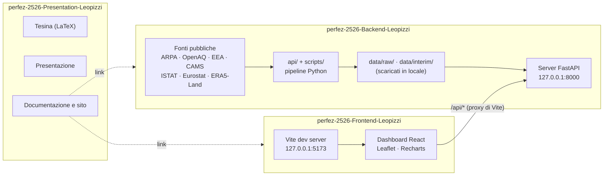

# OneHealth — Presentazione

> Cruscotto di supporto decisionale per presidi medici e aziende sanitarie pubbliche e private, che affianca per zona e nel tempo **qualità dell'aria**, **calore urbano** e **salute** nel Salento (province di Lecce, Brindisi e Taranto, 20 distretti socio-sanitari e 145 comuni), usando solo **dati pubblici**: nessun hardware, nessuna rilevazione sul campo, nessuna interfaccia per il cittadino. La correlazione fra i domini è sempre **esplorativa, non causale**. Include ONE, un assistente che gira in locale (LLM open-source preaddestrato più RAG) e guida verso politiche di medicina di iniziativa.

## Il progetto in tre repository

| Repository | Contenuto |
|---|---|
| [perfez-2526-Presentation-Leopizzi](https://github.com/UniSalento-IDALab-corsoPerfez-25-26/perfez-2526-Presentation-Leopizzi) | tesina, presentazione, documentazione, ricerca ← sei qui |
| [perfez-2526-Backend-Leopizzi](https://github.com/UniSalento-IDALab-corsoPerfez-25-26/perfez-2526-Backend-Leopizzi) | client delle fonti, pipeline, API locale, assistente ONE |
| [perfez-2526-Frontend-Leopizzi](https://github.com/UniSalento-IDALab-corsoPerfez-25-26/perfez-2526-Frontend-Leopizzi) | dashboard e mockup |

## Architettura



## Come si collega agli altri repository

- **Backend**: espone `/api` su `127.0.0.1:8000`; lo schema è in `docs/openapi.json`. **Non contiene dati**: li scarica dalle fonti pubbliche.
- **Frontend**: `npm run dev` apre `127.0.0.1:5173` e gira ogni chiamata `/api/*` al Backend (variabile `ONEHEALTH_API_URL`). Il collegamento è **solo HTTP**: nessuno dei due importa file dell'altro; il contratto è lo schema OpenAPI.
- **Presentation**: documenta il progetto e rimanda agli altri due; nessun codice eseguibile.
- **Versioni**: Backend e Frontend vanno insieme alla stessa versione dell'API (oggi **0.2.0**, tag `v1.0.0` alla consegna).

Si consiglia di clonare i tre repository nella stessa cartella:

```text
OneHealth/
├── perfez-2526-Backend-Leopizzi/
├── perfez-2526-Frontend-Leopizzi/
└── perfez-2526-Presentation-Leopizzi/
```

## Struttura del repository

```text
docs/               sito GitHub Pages (pagina statica, pubblicata dalla cartella /docs)
tesi/               sorgenti LaTeX della tesina (main.tex, capitoli/, media/)
presentazione/      Dichiarazione sull'utilizzo dell'IA e, alla consegna, la presentazione
documentazione/     descrizione del progetto, abstract, stato dell'arte, scelte progettuali,
                    architettura, bibliografia, traccia dell'IDA Lab, un report di validazione
ricerca/            ricognizione dei dataset e confronto fra le fonti
```

## Come leggere i materiali

1. [`documentazione/Descrizione_Progetto.md`](documentazione/Descrizione_Progetto.md) e [`documentazione/Abstract.md`](documentazione/Abstract.md): cosa fa il progetto e perché.
2. [`documentazione/Architettura.md`](documentazione/Architettura.md): come sono fatti Backend e Frontend.
3. [`documentazione/Scelte_Progettuali.md`](documentazione/Scelte_Progettuali.md): ogni scelta con il suo motivo, e perché ogni fonte è stata inserita o scartata.
4. [`documentazione/Stato_Arte.md`](documentazione/Stato_Arte.md), [`ricerca/`](ricerca/) e [`documentazione/Bibliografia.md`](documentazione/Bibliografia.md) (stile Chicago): letteratura, fonti dati e citazioni.
5. [`documentazione/Report_dataset_aria_2024-06.md`](documentazione/Report_dataset_aria_2024-06.md): un esempio di report di validazione a quattro fonti.

Le regole dei dati, gli endpoint e le schede delle singole fonti sono nel repository Backend (`docs/`); la dashboard è nel repository Frontend.

## Compilare la tesina

Servono [MiKTeX](https://miktex.org/), [Strawberry Perl](https://strawberryperl.com/) (per `latexmk`) e, in VS Code, l'estensione **LaTeX Workshop**; `.vscode/settings.json` ricompila a ogni salvataggio. Da terminale:

```bash
cd tesi
latexmk -pdf -interaction=nonstopmode main   # genera main.pdf
latexmk -c                                   # cancella i file ausiliari, tiene il PDF
```

I sorgenti sono sincronizzati con Overleaf. Il PDF finale è allegato alla release.

## Limiti dichiarati

- La correlazione fra aria, calore e salute è esplorativa: fumo, età, comorbidità e aria indoor sono confondenti che nessuna fonte pubblica misura.
- Dove non ci sono stazioni (124 comuni su 145, 8 distretti su 20) l'aria è solo **modellata** (Copernicus CAMS) e viene sempre dichiarata come tale.
- I **decessi** si mostrano solo a distretto × mese (privacy). Nessuna fonte pubblica dà cause di morte o ricoveri sotto la provincia.
- **Ricoveri, accessi in pronto soccorso e accessi ADI sono dati simulati**, calibrati su fonti pubbliche e sempre segnalati come «dato simulato, non reale».
- ARPA Puglia è letta dall'host `old.arpa.puglia.it`, non documentato dall'ente; la licenza CC BY 4.0 dei suoi dati è un'assunzione dichiarata.
- ONE non dà terapie, non nomina persone e arriva al comune, non al quartiere.

## Licenza e contesto

**Documenti (tesina, slide, dichiarazione, documentazione): CC BY 4.0** (v. [`LICENSE`](LICENSE)). Il codice dei repository Backend e Frontend è in Apache-2.0. Le fonti dei dati e le loro licenze sono in `ATTRIBUZIONI.md` del repository Backend.

Progetto d'esame del Corso di Perfezionamento in Tecnologie Digitali per Ambienti e Sistemi Intelligenti, Università del Salento (IDA Lab), sviluppato con l'azienda partner Parsec 3,26 (Lecce). Autore: Matteo Leopizzi. Referente aziendale: Sergio Guglielmi. Referente accademico: prof. Luigi Patrono. Anno accademico 2025/2026.
