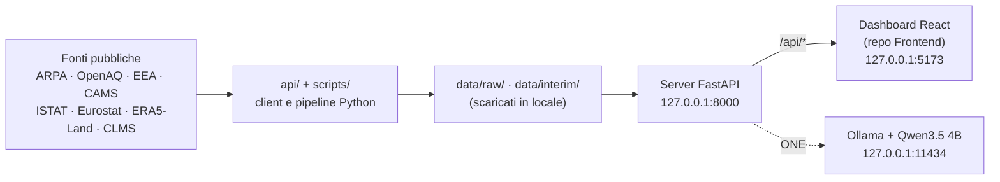

# Architettura

OneHealth è un cruscotto di supporto decisionale per presidi medici e aziende sanitarie che affianca, per zona e nel tempo, **qualità dell'aria**, **calore urbano** e **salute** nel Salento, usando solo **dati pubblici**. Nessun hardware, nessuna rilevazione sul campo, nessuna interfaccia per il cittadino.

Questo documento descrive il **Backend**. Il progetto è in tre repository (Presentation, Backend, Frontend); il Frontend e il Backend si parlano solo via HTTP.

## 1. Quattro componenti

1. **Acquisizione**: client delle fonti pubbliche, con chiamate API dirette (`api/`). Un client per fonte, con controllo a monte del payload.
2. **Pipeline**: validazione, pulizia, unificazione per zona, sovrapposizione temporale e geografica dei domini (`api/*/dataset_*.py`, `api/comune/`, `scripts/`).
3. **Server e dashboard**: un'API locale FastAPI (`localhost/server/`) serve la dashboard React del repository Frontend.
4. **Assistente ONE** (`localhost/rag/`): LLM open-source **preaddestrato, in locale** (Qwen3.5 4B via Ollama) con RAG, un assistente per card. Nessun training né fine-tuning. Risponde solo su un elenco chiuso di argomenti e analisi; il resto riceve il rifiuto fisso «La richiesta non può essere processata o non esiste nessun dato a riguardo nel sistema.».



## 2. Stack

| Strato | Tecnologia |
|---|---|
| Client delle fonti e pipeline | Python, `requests`, `pandas`, `pyarrow` (parquet) |
| Persistenza | JSON e parquet su disco; **nessun database** |
| Interrogazione | SQL su **SQLite in memoria**, ricostruito dai file a ogni avvio |
| API locale | FastAPI + uvicorn; schema OpenAPI in [`openapi.json`](https://github.com/UniSalento-IDALab-corsoPerfez-25-26/perfez-2526-Backend-Leopizzi/blob/main/docs/openapi.json) |
| Ambiente Python | `uv` (`pyproject.toml` + `uv.lock`) |
| Assistente | Ollama, modello Qwen3.5 4B, RAG su documenti `.md` del progetto |

**SQL senza database.** Il vincolo «nessun database persistente» non impedisce di usare SQL: i file vengono caricati in uno SQLite in memoria che muore col processo. I file restano la fonte di verità e l'unica cosa su disco.

## 3. Gratuità e località

Nessun servizio a pagamento, a crediti, a quota o con prova a scadenza: né per i dati, né per la mappa, né per l'AI, né per l'hosting.

- Le chiavi richieste sono **gratuite** (OpenAQ, Copernicus: v. [`../.env.example`](https://github.com/UniSalento-IDALab-corsoPerfez-25-26/perfez-2526-Backend-Leopizzi/blob/main/.env.example)); ARPA, EEA, ISTAT ed Eurostat non ne hanno.
- La mappa usa i tile **OpenStreetMap** senza chiave (attribuzione ODbL).
- **Tutto gira su `127.0.0.1`**, sulla workstation di chi lo avvia. L'LLM è locale per scelta del committente (Parsec 3,26): niente cloud né server aziendale.

## 4. Struttura del repository

```text
api/            client delle fonti e pipeline (package Python, import assoluti)
  comune/       condiviso: distretti, confini, anagrafiche, stati, aggregazione, celle → comuni, client CKAN
  aria/         client, adattatori delle fonti (fonti/), archivio incrementale, report
  salute/       ISTAT, Eurostat, Health for All, simulazione
  calore/       ERA5-Land, ARPA meteo, CLMS, soglie, dataset
scripts/        script eseguibili: aria/, calore/, salute/, territorio/, dashboard/, backend/, rag/
localhost/
  server/       API FastAPI, modelli Pydantic, dati in SQLite in memoria
  rag/          assistente ONE: client Ollama, documenti/, analisi, schede dei fatti, perimetro
data/
  territorio/   anagrafica, confini, elenchi dei presidi
  dataset/      anagrafiche relazionali e file di riferimento
  raw/ interim/ dati scaricati e generati (non versionati)
docs/           questa documentazione
```

Il percorso `localhost/server/` è tenuto così per non rompere gli import (`localhost.server.*`).

## 5. Collegamento con il Frontend

- **Solo HTTP.** Il browser apre la dashboard su `http://127.0.0.1:5173`; Vite gira ogni chiamata `/api/*` a questo server su `http://127.0.0.1:8000`, così il browser vede una sola origine. Il Frontend non importa file del Backend e viceversa.
- **Contratto**: lo schema OpenAPI del server ([`openapi.json`](https://github.com/UniSalento-IDALab-corsoPerfez-25-26/perfez-2526-Backend-Leopizzi/blob/main/docs/openapi.json), rigenerabile con `uv run scripts/backend/esporta_openapi.py`). Il Frontend ne genera i tipi TypeScript.
- **Configurazione**: `ONEHEALTH_HOST`, `ONEHEALTH_PORT` e `ONEHEALTH_ORIGINI` (CORS) lato Backend; `ONEHEALTH_API_URL` lato Frontend (v. `.env.example`).
- **Stato e versione**: `GET /api/stato` dice se il server è vivo, con quale versione dell'API e che dati ha in locale. Backend e Frontend vanno insieme alla stessa versione.
- **Avvio a vuoto**: il Backend non contiene dati. Parte e risponde anche senza nulla in `data/raw/` e `data/interim/` (gli endpoint dicono «non ancora scaricato»); `scripts/backend/prepara_dati.py` li scarica.
- **Apertura immediata**: all'avvio il server calcola in background le risposte della finestra iniziale e le tiene in memoria, scartandole appena i dati cambiano (`localhost/server/risposte_iniziali.py`).

## 6. Regole dei dati

Stati del dato, formato, aggregazione, grane, dato modellato e privacy: [`Regole_dei_dati.md`](https://github.com/UniSalento-IDALab-corsoPerfez-25-26/perfez-2526-Backend-Leopizzi/blob/main/docs/Regole_dei_dati.md).
